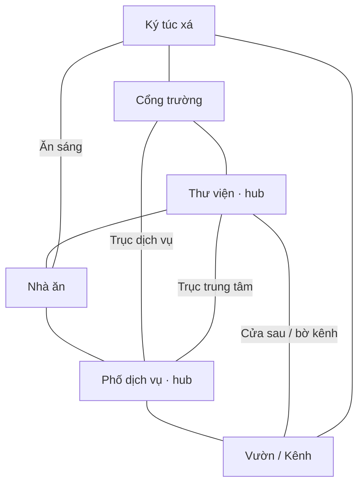

# Campus network v1 — mặt bằng và warp 20×15

Thiết kế mới theo yêu cầu người dùng: sáu khu trong một campus đại học Giang
Nam 2026; di chuyển thuận tiện cho học tập, ăn sáng, mua đồ, nhận hàng và
nghỉ bên kênh. Giữ nhân vật, pixel art, palette ấm và nhận diện trường.
Đây là **bản bàn giao level layout**, chưa thay runtime, save hoặc asset hiện có.

## Tệp bàn giao

- [maps.json](maps.json): một JSON array gồm sáu map, mỗi map đúng ba khóa
  `map_name`, `layout`, `warps`; mỗi layout 15 hàng × 20 cột.
- [ascii-maps.md](ascii-maps.md): bản vẽ đủ sáu khu, tọa độ, cầu, landmark,
  bảng tin và các cổng N/E/S/W; được dựng từ chính dữ liệu JSON.
- [warp-matrix.csv](warp-matrix.csv): mười cặp kết nối, cổng và tọa độ đến.
- [validation.json](validation.json): kết quả kiểm dữ liệu; không phải playtest.
- [build.py](build.py): dựng lại dữ liệu/ASCII/CSV hoặc kiểm JSON sau khi sửa.

## Quyết định về mạng và nhịp chơi

Chọn **hai hub liên thông: Thư viện và Phố dịch vụ**, mỗi hub bốn hướng;
bốn khu còn lại có ba hướng tới ba khu khác nhau. Giữ sáu liên kết của
vòng cũ, thêm đúng ba lối tắt người dùng gợi ý và trục Thư viện–Phố.



So phương án:

| Phương án | Kết quả | Quyết định |
| --- | --- | --- |
| Vòng sáu khu cũ | Mỗi khu hai láng giềng, tối đa ba lần chuyển map | Không giữ làm định hướng mới |
| Vòng + ba lối tắt | Mỗi khu ba láng giềng, tối đa hai lần chuyển; không có hub nổi bật theo degree | Giữ ba lối tắt làm nền |
| Thêm trục Thư viện–Phố | Hai hub bốn láng giềng, vẫn tối đa hai lần chuyển | Chọn vì nối trực tiếp khu học với dịch vụ sinh viên |

Trung bình theo 15 cặp khu khác nhau: vòng cũ 1,8 lần chuyển, mạng mới
1,33 lần. Đây là số tính trên graph, **không phải thời gian đi bộ đã đo**.
Các lối đi mở ngay; điều kiện học/nhiệm vụ vẫn nằm ở nội dung tương tác,
không khóa đường tắt để kéo dài lượt chơi.

## Địa lý campus và cách đọc hướng

```text
                                   BẮC

                         [VƯỜN / KÊNH]
    [KÝ TÚC XÁ]          kênh Bắc–Nam, hai cầu

                                              [NHÀ ĂN]
                 [THƯ VIỆN · HUB]

                                  [PHỐ DỊCH VỤ · HUB]
           [CỔNG TRƯỜNG]

                                   NAM
    TÂY                                               ĐÔNG
```

Đây là phân bố tương đối các **cụm chức năng**, không phải vị trí đặt sáu
rectangle trong một Tiled World liền mạch. Đường từ ký túc tới cổng uốn về
phía nam theo trục tiếp cận phía tây; lối đi ăn sáng đi qua sân nội bộ tới
nhà ăn phía đông; vườn là cụm cảnh quan phía bắc với lối dạo về dịch vụ.
Hướng của warp là hướng ở **miệng đường trong cảnh**, không có nghĩa toàn
bộ tuyến giữa hai cụm phải là một đoạn thẳng.

Giữ cả vòng sáu khu và ba đường nối đối diện tạo đồ thị K3,3: không thể vẽ
tất cả tuyến như những đoạn đường rời trên một mặt phẳng mà không giao nhau.
V1 dùng warp để nén các đoạn đường nội bộ giữa khung hình. Nếu sau này dựng
campus liền mạch, cần bố trí nút giao trong map hoặc xử lý giao cắt bằng
cầu bộ hành/hành lang khác cao độ; không ghép sáu JSON thành lưới ảnh rồi
khẳng định đã có địa lý liền mạch. Hai cầu được vẽ trong garden chỉ là cầu
qua kênh, không tự giải quyết mọi giao cắt trên sơ đồ campus.

| Map ID | Tên | Vị trí và vai trò |
| --- | --- | --- |
| dorm | Ký túc xá | Tây Bắc, khu ở, tiếp cận ăn sáng và cảnh quan |
| gate | Cổng trường | Phía Nam, khu đón tiếp ở bên trong trường; không có warp ra thành phố |
| library | Thư viện | Trung tâm, hub học tập và sân định hướng |
| canteen | Nhà ăn | Phía Đông Bắc, phục vụ và sân ăn có lối xuyên riêng |
| street | Phố dịch vụ sinh viên | Đông Nam, hub dịch vụ nội khu, mua đồ và nhận hàng |
| garden | Vườn/Kênh | Phía Bắc, hai bờ kênh, pavilion và đường dạo |

## Quy ước tọa độ và JSON

- X tăng về Đông (0..19); Y tăng về Nam (0..14); truy cập `layout[y][x]`.
- Giữ map ID `dorm`, `gate`, `library`, `canteen`, `street`, `garden` để dễ
  đối chiếu ID đang có. `to_map` dùng đúng các ID này.
- Tile 0 = cỏ đi được; 1 = đường đất/đường đi được; 2 = tường/rào/footprint
  cản đường; 3 = nước cản đường; 9 = warp đi được. Không thêm Tile ID khác.
  Tại vùng cầu, tile 1 là mặt đi bộ bắc qua kênh; dấu `=` chỉ có trong ASCII.
- Chỉ tile 9 trên cạnh là lối ra. Những cạnh còn lại kín bằng tile 2; không
  có warp ở góc. Mỗi miệng đường rộng hai tile để dễ nhận diện/điều khiển.
- Cổng Đông/Tây dùng Y=7,8. Cổng Bắc/Nam dùng X=9,10. Các cặp cạnh đối ứng
  khớp **toàn bộ dãy địa hình trên cạnh**, kể cả phần rào ngoài miệng đường.
- `from_x/from_y` là ô 9 ở mép. `to_x/to_y` là **điểm xuất hiện lùi một ô
  vào trong map đích**, trên tile 1; không phải ô trigger ngược. Cách này
  tránh vòng lặp warp khi engine kích hoạt ngay lúc bước lên tile 9.
- `facing_direction` là hướng nhìn **sau khi đến**, dùng `north/south/east/west`.
  Ví dụ đi ra Đông → đến sát cạnh Tây, nhìn Đông và tiếp tục vào map mới.

Ví dụ: `dorm (19,7) → gate (1,7)`; cổng ngược ở `gate (0,7)` và đưa về
`dorm (18,7)`. Hai miệng đường vẫn là `(19,7) ↔ (0,7)` như quy chuẩn;
chỉ điểm xuất hiện lùi vào trong. Không áp dụng cách đặt lại giữa map cũ.

## Warp Matrix — đủ mười cặp hai chiều

Trong bảng, `y=7..8` và `x=9..10` đều là **hai ô riêng**, có hai object
warp riêng cho mỗi chiều. Toàn mạng có 40 object warp, 20 mỗi chiều cộng gộp.

| Tuyến | Cổng A | Cổng B | Chức năng |
| --- | --- | --- | --- |
| R01 | dorm Đông `(19,7..8)` | gate Tây `(0,7..8)` | Tiếp cận khu ở–đón tiếp |
| R02 | gate Đông `(19,7..8)` | library Tây `(0,7..8)` | Đón tiếp–học tập |
| R03 | library Bắc `(9..10,0)` | canteen Nam `(9..10,14)` | Học tập–ăn uống |
| R04 | canteen Tây `(0,7..8)` | street Đông `(19,7..8)` | Ăn uống–dịch vụ |
| R05 | street Tây `(0,7..8)` | garden Đông `(19,7..8)` | Dạo ven kênh–dịch vụ |
| R06 | garden Nam `(9..10,14)` | dorm Bắc `(9..10,0)` | Cảnh quan–khu ở |
| R07 | dorm Nam `(9..10,14)` | canteen Bắc `(9..10,0)` | Lối tắt đi ăn sáng |
| R08 | gate Bắc `(9..10,0)` | street Nam `(9..10,14)` | Lối tắt trục đón tiếp–dịch vụ |
| R09 | library Đông `(19,7..8)` | garden Tây `(0,7..8)` | Lối tắt cửa sau–bờ kênh |
| R10 | street Bắc `(9..10,0)` | library Nam `(9..10,14)` | Trục nối hai hub |

Toàn bộ tọa độ điểm xuất hiện đã được mở rộng trong JSON và CSV; không cần
tự suy lại từ ký hiệu khoảng của bảng trên.

## Đường đi, landmark và bảng chỉ dẫn

Trung tâm mỗi map có chỗ quyết định quanh `(9,7)`, đường chính rộng hai ô.
Các nhánh tới ngưỡng công trình là đường 1 nối mạng chính. Cỏ 0 vẫn đi được;
người chơi không bị ép đi trên một đường ray. Footprint là khối cản, chưa
tạo nội thất hoặc tương tác mới. Các cửa do art thể hiện phải bám ngưỡng
tiếp cận có đường, không tự biến một tile tường thành lối vào.

| Khu | Bố cục riêng | Nội dung bảng chỉ đường gần nút quyết định |
| --- | --- | --- |
| Ký túc | Hai khối ở/sinh hoạt; đường ăn sáng về Nam; hướng vườn về Bắc | `↑ Vườn/Kênh · → Cổng trường · ↓ Nhà ăn` |
| Cổng | Hai khối đón tiếp và trụ cổng phía Nam, đường xuyên Đông–Tây | `← Ký túc · ↑ Phố dịch vụ · → Thư viện` |
| Thư viện | Hai cánh học, nút bốn hướng, sân nước nhỏ ở Tây Nam | `← Cổng · ↑ Nhà ăn · → Vườn/Kênh · ↓ Phố dịch vụ` |
| Nhà ăn | Khối phục vụ và khối ăn; sân/bàn ở Đông Nam, không lấn đường xuyên | `↑ Ký túc · ← Phố dịch vụ · ↓ Thư viện` |
| Phố | Quầy thực phẩm và bưu kiện, vòng sân mua sắm, khu xe đạp phía Nam | `← Vườn/Kênh · ↑ Thư viện · → Nhà ăn · ↓ Cổng` |
| Vườn/Kênh | Nước dọc X=5..6; cầu chính Y=7..8, cầu phụ Y=3..4; pavilion Đông Bắc | `← Thư viện · → Phố dịch vụ · ↓ Ký túc` |

Các ô `s` trong ASCII là vị trí bảng gắn trên tường/khung đã cản, gần đường
tiếp cận; không thêm cột giữa đường. Ở nhánh trước exit, có thể dùng mũi tên
UI/biển gắn tường cùng nội dung và một landmark nhìn thấy được. Nếu cần
biển đứng riêng, phải chọn lại vị trí hợp lệ trên layout và kiểm đường đi.
Chữ trên biển là lớp text có thể dịch/đọc, không bake Hán/pinyin vào ảnh nền.

Trong garden, cầu chính tiếp tuyến Đông–Tây và cầu phụ tạo vòng dạo hai bờ;
hai đầu mỗi cầu đều chạm đường 1. Kênh được thể hiện trong khu cảnh quan;
đầu nước sát biên kín có thể diễn đạt bằng cống/bờ kè, không tạo exit thứ tư.

## Tham khảo và nguyên tắc áp dụng

[Pelican Town](https://stardewvalleywiki.com/Pelican_Town) và
[Cindersap Forest](https://stardewvalleywiki.com/Cindersap_Forest) minh họa
các vùng có nhiều lối nối theo hướng và chức năng. Áp dụng cho campus:
mỗi hướng dẫn tới một nơi cụ thể, đường xuyên đọc được, landmark khác nhau
và các tuyến vòng tạo lựa chọn quay lại. Đây là suy luận thiết kế từ cách
tổ chức vùng; không sao chép map, tỷ lệ, tileset hay asset Stardew Valley.

## Bàn giao cho code/Tiled và art

JSON này là **schema giản lược theo yêu cầu**, không phải JSON native của
Tiled. Tiled cần tile layers, tilesets và object properties; xem
[JSON Map Format](https://doc.mapeditor.org/en/stable/reference/json-map-format/).
Không nạp file này trực tiếp như `.tmj` mà chưa chuyển đổi schema.

Khi chuyển sang Tiled:

1. Tạo sáu map orthogonal 20×15, giữ nguyên ID; đưa `layout` vào lớp logic.
2. Semantic ID 0 của tài liệu là cỏ, trong khi GID 0 của Tiled là ô trống.
   Với tileset năm ô liên tiếp, `firstgid=1`, dùng ánh xạ `{0:1,1:2,2:3,3:4,9:5}`;
   không chép nguyên semantic 0 thành GID 0. Xem [Global Tile IDs](https://doc.mapeditor.org/en/stable/reference/global-tile-ids/).
3. Tạo object warp tại từng ô 9, lưu `to_map/to_x/to_y/facing_direction` làm
   custom properties. Rect pixel của ô là `(x*T,y*T,T,T)`; actor đến tâm
   tile `(to_x+0.5,to_y+0.5)*T`, điều chỉnh anchor theo sprite thực tế.
4. Tile 2/3 cản; tile 0/1/9 đi được. Cầu vẫn là tile 1, không để collision
   nước phủ lên mặt cầu trong lớp art mới.
5. Tách lớp art, logic/collision, text và warp. Trang trí không thay đổi
   tile logic. Mái không phủ vùng đi khi renderer chưa hỗ trợ foreground.

`T` là tile size chọn ở bước tích hợp. Ví dụ tile vuông 32 px cho khung
640×480 (4:3); không kéo giãn không đều thành viewport 960×540. Cần camera,
letterbox hoặc viewport phù hợp. Chưa xác nhận bề rộng hai tile đáp ứng
bounds sprite thực tế; phải kiểm bằng nhân vật trước khi sản xuất art cuối.

Runtime hiện tại chỉ đọc hai exit trái/phải trong manifest và có collider
world-unit cũ. Bước triển khai tiếp cần loader/schema cho bốn hướng, chuyển
tile↔world, arrival gần mép, focus/input và kiểm NPC/quest/save. Không thay
`scene.exits` thành mảng ba/bốn phần tử rồi coi runtime đã hỗ trợ mạng mới.

## Kiểm chứng đã thực hiện và phần còn lại

Chạy từ gốc repo:

```powershell
python -X utf8 docs/game-dev/campus-network-v1/build.py --check
```

Đã kiểm kích thước/Tile ID/schema, toàn bộ vùng đi được, đường 1 từ trung
tâm tới mọi exit, 40 warp đăng ký đủ, ghép ngược chính xác, mép khớp địa
hình/tọa độ, điểm đến lùi vào trong, degree 3–4 và graph diameter 2. Bản
ASCII và CSV sinh từ cùng nguồn để tránh lệch bảng với JSON.

Đã thử bảy bản dữ liệu cố ý sai trong bộ nhớ: thiếu warp, điểm đến rơi lên
trigger, sai Y của cổng đối ứng, đường Bắc bị chặn, thiếu mặt cầu, Tile ID
ngoài quy ước và khóa JSON thừa. Validator đều từ chối; không lưu các bản
sai vào file bàn giao. Đã đối chiếu lại từng ô ASCII và mười dòng CSV với JSON.

Còn phải kiểm sau tích hợp: đi cả 20 chiều của 10 tuyến, hai ô mỗi miệng,
không bật ngược warp, bounds nhân vật, camera, collision cầu/nước, landmark,
biển chỉ đường, lịch NPC, quest/save/reload và playtest khả năng tìm đường.
Kết quả kiểm dữ liệu không thay thế những bước này.
